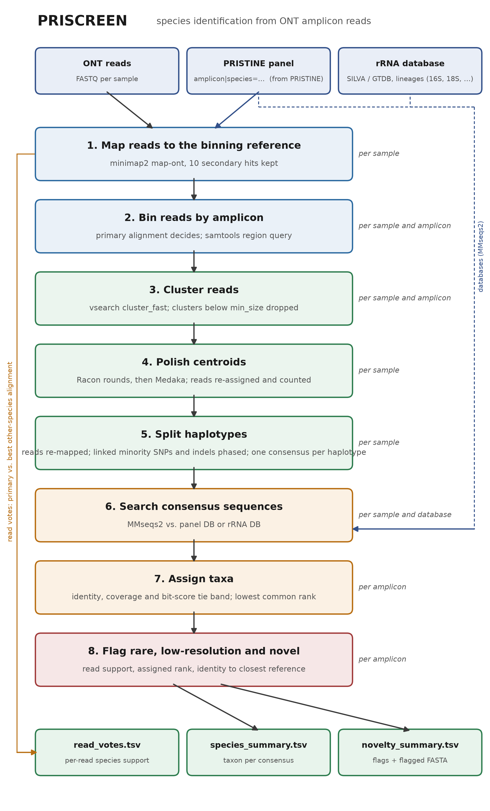

# PRISCREEN

Species identification from Oxford Nanopore (ONT) amplicon reads: custom amplicons
designed with [PRISTINE](https://github.com/AI-Biome/PRISTINE) and rRNA amplicons
(16S, 18S, ITS, ...) in the same sequencing run.

Authors: Tomas Kudlacek, Katharina J. Hoff

Contact: tomas.kudlacek@uni-greifswald.de

Version: 0.2.0

## What it does

A sample is a FASTQ file of ONT reads from one or several PCR products: the
PRISTINE amplicons of a target group (each amplified from the target and its
close non-target relatives) and, optionally, universal rRNA amplicons. For every
sample PRISCREEN

1. bins the reads by amplicon,
2. clusters the reads of each amplicon and polishes the cluster centroids into
   consensus sequences (Racon, Medaka),
3. splits the consensus of a cluster that mixes close variants (species a few
   SNPs apart, closer than the read error) into haplotypes by phasing the reads,
4. identifies each consensus against the matching database: PRISTINE amplicons
   against the panel of predicted amplicon variants (species-labelled), rRNA
   amplicons against a taxonomy-labelled database such as SILVA or GTDB,
5. flags consensus sequences that are rare, resolved only to a high rank, or far
   from every reference (candidate novel taxa), and
6. counts, per PRISTINE amplicon, how many reads support each species variant,
   an independent check of the haplotype calls.



The figure is generated by `python docs/make_pipeline_figure.py`; `rulegraph.png`
is Snakemake's rule graph (`pixi run rulegraph`).

## Installation

Dependencies are managed with [pixi](https://pixi.sh) from the conda-forge and
bioconda channels only (no Anaconda `defaults` channel). After installing pixi:

```bash
git clone https://github.com/AI-Biome/PRISCREEN.git
cd PRISCREEN
pixi install          # ./.pixi with snakemake, minimap2, samtools, vsearch, racon, medaka, mmseqs2, chopper ...
pixi run test         # optional: unit tests and a dry run of the workflow
```

Everything runs inside the pixi environment: either prefix commands with
`pixi run`, or open a shell with `pixi shell` and call `snakemake` directly. The
environment is Linux x86-64 (Medaka and Racon are not available for macOS on
bioconda).

Medaka downloads its basecaller-specific model on first use. On a cluster
without internet access on the compute nodes, fetch the models once from the login
node: `pixi run medaka tools download_models`.

### Containers

Every rule can run in a public container instead of the local pixi environment:
one [BioContainers](https://biocontainers.pro) image per tool (minimap2,
samtools, vsearch, MMseqs2, chopper, Racon, Medaka, pandas), pinned in
`config/config.yaml` under `containers:`. No image of our own is built or
published. The SLURM profile uses them by default; the host then needs only
Snakemake and the SLURM executor, which the slim `host` environment provides:

```bash
pixi install -e host                                   # snakemake + SLURM plugin only, no tools
pixi run -e host snakemake --profile profiles/slurm    # jobs run in the containers
pixi run snakemake --profile profiles/local --cores 8  # local run in the containers
```

Images are pulled once into `.snakemake/singularity/`. On a cluster without
internet on the compute nodes, pull them on the login node (a dry run with
`--sdm apptainer` lists them; `singularity pull <uri>`) and point the
`containers:` keys at the `.sif` files. Singularity binds the working
directory, `$HOME` and `/tmp` by default and the profile adds `-B /home`; data,
repository and results must lie under bound paths (add `-B /scratch` and the
like to `apptainer-args` in the profiles). Snakemake starts the containers with
its own home setting, which switches off Singularity's default `$HOME` bind,
hence the explicit `-B /home` in both profiles; a bare `--sdm apptainer` without
it fails with "does not exist" for files under `/home`. Medaka looks for models in its
package directory (read-only inside the image) and in `~/.medaka/data`, where it
caches downloads, so one download serves all jobs; without internet on the
compute nodes run `medaka tools download_models --models <name>` once on the
login node.

## Quick start with the toy data

The repository ships two toy samples (`data/Test1.fastq.gz`, `data/Test2.fastq.gz`),
a two-amplicon panel (`data/reference_amplicons.fasta`) and a four-sequence
"16S database" (`data/toy_16S_db.fasta`). `config/config.yaml` points at them.

```bash
pixi run snakemake -n --cores 4      # dry run: 58 jobs
pixi run snakemake --cores 4         # about 4 minutes; writes results/ and logs/
column -t -s $'\t' results/identify/Test2/species_summary.tsv
```

Test2 contains reads of three species of amplicon `amp1` (SpeciesA and
SpeciesB about 2 % apart; SpeciesD differs from SpeciesA by three indels only),
two species of `amp2` (SpeciesB and SpeciesC, 3 SNPs apart), 60 reads of a toy
16S sequence and 8 unmappable reads. The run yields one consensus per species
and amplicon: SpeciesB of `amp1` forms its own cluster, SpeciesA and SpeciesD
share one and are separated by the haplotype step through the indels
(`separated_by: indel`), and so are the two `amp2` species through the SNPs.
The 16S consensus is identified as *Toyibacter primus*, and `read_votes.tsv`
reports 40/50/30 reads for the `amp1` species and 50/30 for the `amp2` species.

## Input

### Sample sheet

`config/samples.tsv` (tab separated; paths relative to the PRISCREEN directory
or absolute):

```tsv
sample	fastq
S1	data/S1.fastq.gz
S2	/data/run42/S2.fastq.gz
```

Sample names must not contain spaces or slashes.

### PRISTINE panel

The panel is a FASTA file with one record per amplicon variant:

```text
>accn_CP130901_480000_482000|species=Yersinia_pseudotuberculosis|genome=Yersinia_pseudotuberculosis_1
GGTATAGAGCCTGACCGGGA...
>accn_CP130901_480000_482000|species=Yersinia_pestis|genome=Yersinia_pestis_1
GGTATAGAGCCTGACCGGGA...
```

The text before the first `|` is the amplicon (locus) id; `species=` is required;
further `key=value` fields are optional. Reads are binned by amplicon id, and all
variants of an amplicon together form the search database of that amplicon.

PRISTINE writes the predicted amplicon of every input genome to
`<output>/<group>/primers/amplicons/<locus>_amplicons.fasta`, with the genome id
as header. Two ways to use that output directly:

```bash
# a) convert once (one or several PRISTINE output directories, groups or amplicons/ folders)
pixi run python scripts/pristine_to_panel.py /path/to/pristine/output -o data/my_panel.fasta
# then:  panel: {fasta: data/my_panel.fasta}

# b) let the workflow build the panel
# config.yaml:  panel: {pristine_output: /path/to/pristine/output}
```

A PRISTINE run that writes `priscreen_panel.fasta` itself (at the output root
or in `<group>/primers/`; format in `docs/priscreen_panel_format.md`) is used as
is, and the conversion is skipped for the groups that have one.

The species of a PRISTINE genome is its id without the trailing `_<i>`
(`Yersinia_pestis_2` is species `Yersinia_pestis`), the same rule PRISTINE uses.
Identical sequences of one locus and species are written once. Non-target genomes
of the PRISTINE run become panel variants too, which is what lets PRISCREEN tell
the target from its relatives.

### rRNA amplicons

Each entry under `rrna:` is one amplicon identified against its own database:

```yaml
rrna:
  16S:
    database: data/db/SILVA_138.2_SSURef_NR99_tax_silva_prok.fasta
  18S:
    database: data/db/SILVA_138.2_SSURef_NR99_tax_silva_euk.fasta
```

`database` is a FASTA file whose headers carry the lineage. Recognised formats:

| Source | Header example |
| --- | --- |
| SILVA SSURef (NR99) | `>AB001.1.1500 Bacteria;Pseudomonadota;...;Escherichia-Shigella;Escherichia coli` |
| GTDB SSU | `>RS_GCF_000006945.2~NC_003197.2 d__Bacteria;p__...;s__Salmonella enterica [location=...]` |
| SINTAX / UNITE style | `>X1;tax=d:Bacteria,p:Bacillota,...,s:Bacillus_subtilis;` |
| key=value | `>id\|tax=Bacteria;Bacillota;...;Bacillus subtilis` or `>id\|genus=Bacillus\|species=Bacillus_subtilis` |

SILVA has no rank labels: a seven-level lineage is read as domain, phylum, class,
order, family, genus, species; longer lineages (eukaryotes, subclasses) keep the
first level as domain and the last two as genus and species. Names such as
`uncultured bacterium` count as unknown at that rank. The database is also the
reference that recognises the reads of this amplicon during binning. With a
smaller `bin_reference` (for instance a few hundred representative sequences)
mapping is faster; when several rRNA amplicons are configured, each needs its
own `bin_reference` (reads cannot be split between two amplicons that share the
same reference), e.g. the prokaryotic and the eukaryotic part of SILVA:

```bash
gunzip -c SILVA_138.2_SSURef_NR99_tax_silva.fasta.gz \
  | awk 'BEGIN{RS=">";ORS=""} NR>1 && $0 !~ /^[^\n]* Eukaryota;/ {print ">"$0}' > silva_prok.fasta
gunzip -c SILVA_138.2_SSURef_NR99_tax_silva.fasta.gz \
  | awk 'BEGIN{RS=">";ORS=""} NR>1 && $0 ~  /^[^\n]* Eukaryota;/ {print ">"$0}' > silva_euk.fasta
```

A run may have only rRNA amplicons (`panel: {fasta: null}`) or only the panel.

### Configuration file

`config/config.yaml`, with defaults:

```yaml
samples: config/samples.tsv

containers:                   # one BioContainers image per tool, used with --sdm apptainer
  minimap2: docker://quay.io/biocontainers/minimap2:2.31--h118bc1c_0
  minimap2_samtools: docker://quay.io/biocontainers/mulled-v2-66534bcbb7031a148b13e2ad42583020b9cd25c4:ad4c240457048f1d3cc0bd8c8fa39bf27d222eb7-0
  samtools: docker://quay.io/biocontainers/samtools:1.24--h9dcdb79_1
  vsearch: docker://quay.io/biocontainers/vsearch:2.32.0--hd2be7a0_0
  mmseqs2: docker://quay.io/biocontainers/mmseqs2:18.8cc5c--hd6d6fdc_0
  chopper: docker://quay.io/biocontainers/chopper:0.15.0--h7f49ad2_0
  racon: docker://quay.io/biocontainers/racon:1.5.0--h077b44d_8
  medaka: docker://quay.io/biocontainers/medaka:2.2.1--py311h063c2b6_0   # also minimap2, samtools, pysam, numpy
  python: docker://quay.io/biocontainers/pandas:2.2.1                    # Python + pandas for the table scripts

panel:
  fasta: data/reference_amplicons.fasta
  pristine_output: null       # PRISTINE output directory (or list); overrides fasta

rrna:                         # see above; "rrna: null" in an override config drops the default entry
                              # (Snakemake merges --configfile values into config/config.yaml)
  16S:
    database: data/toy_16S_db.fasta
    bin_reference: null       # default: the database

filter:                       # chopper, before mapping
  enable: false
  min_length: 200
  max_length: 0               # 0 = none
  min_quality: 9

cluster:
  id_threshold: 0.93          # read-to-centroid identity; 0.93 for HAC reads (<= 3 % error), 0.96 for Q20+/SUP
  min_size: 3                 # smaller clusters are not polished (their reads are re-assigned afterwards)

consensus:
  racon_rounds: 2
  medaka: true
  medaka_model: null          # null: medaka reads the basecaller model from the FASTQ headers
  medaka_bacteria: false      # medaka --bacteria when no model is given
  keep_intermediate: false

haplotypes:                   # split consensus sequences of mixed clusters (see below)
  enable: true
  min_reads: 5                # reads a minority allele and a haplotype need
  min_allele_frac: 0.15       # minimum frequency of the minority allele at a position (and of a haplotype)
  min_depth: 20
  min_base_quality: 10
  min_linkage: 0.8            # fraction of reads whose allele must agree with the grouping
  min_variants: 1             # linked sites a split needs; 2-3 for a conservative split
  max_haplotypes: 4           # per consensus
  indels: true                # deletions and insertions are sites too (false: substitutions only)
  hp_min_run: 4               # 1-nt indel in a homopolymer of >= this length = weak site; it needs
  hp_min_allele_frac: 0.2     # this allele frequency and cannot start a split on its own
  keep_bam: false

identify:
  enable: true                # false: stop after the consensus sequences
  min_pident: 98.5            # percent identity a hit needs
  min_qcov: 0.90              # fraction of the consensus covered by the hit
  top_delta: 0.01             # bit-score tie band (see below)
  max_seqs: 300
  index_rrna_db: false        # MMseqs2 index for rRNA databases: ~9 GB disk and RAM, pays off with many samples
  vote_min_margin: 4          # alignment-score margin for a "clear" read vote

novelty:
  min_reads: 5
  min_rel_abundance: 0.0
  novel_pident: 97.0          # percent
  novel_qcov: 0.90
  min_resolved_rank: genus

threads: {map: 8, polish: 8, mmseqs: 8}
resources: {mem_mb_per_cpu: 2600, runtime_min: 120}   # SLURM only
```

## Running

```bash
pixi run snakemake --cores 16                     # local, pixi environment
pixi run snakemake --cores 16 --configfile my_config.yaml
pixi run snakemake --profile profiles/local --cores 16   # local, tool containers
pixi run -e host snakemake --profile profiles/slurm      # SLURM + containers; edit the partition in profiles/slurm/config.yaml
```

Jobs submitted to SLURM run inside the tool containers (see Installation,
Containers); without `--sdm apptainer` they use the pixi environment through
`PATH`. Memory is requested as `mem_mb_per_cpu` times the threads of a rule (at
least 1 to 8 GB depending on the rule) and the runtime as `runtime_min`. `snakemake -n` shows
the plan, `snakemake --rerun-incomplete` resumes after a failure, and
`logs/<rule>/` holds one log per job.

## How it works

Step numbers follow the figure. Rule names are in brackets.

1. Map reads [`map_to_reference`]. All reads of a sample are mapped with
   minimap2 (`map-ont`, up to 10 secondary alignments) to one reference that holds
   the panel and the `bin_reference` of every rRNA amplicon (headers prefixed with
   the amplicon name). Optionally [`filter_reads`] removes short and low-quality
   reads first (chopper).
2. Bin reads [`bin_reads`]. A read belongs to the amplicon of its primary
   alignment; secondary and supplementary alignments never bin a read. Bins are
   extracted from the sorted BAM with region queries, so the FASTQ is read once
   per sample.
3. Cluster [`cluster_reads`]. vsearch `--cluster_fast` at `id_threshold`
   groups the reads of an amplicon into sequence variants, with minimap2-like
   gap penalties (gap open 4, extension 2): vsearch's defaults (gap open 20)
   turn the indels of ONT reads into mismatches and push the identity of a read
   to its centroid several percent below the true divergence. Raw ONT reads of
   one variant differ from each other by roughly twice the read error rate, so
   the threshold must stay below that; close variants that end up in one
   cluster are separated in step 5. Clusters with fewer than `min_size` reads
   cannot be polished and are dropped here (their reads are counted in step 4).
4. Polish [`polish_prepare`, `racon_map`, `racon`, `medaka`, `count_mapped`,
   `consensus_collect`]. The centroids of all amplicons of a sample are polished
   together: reads are mapped to all centroids (primary alignments only, so
   each read polishes one centroid), Racon runs `racon_rounds` times, then
   Medaka once per sample (each tool in its own container). The reads mapped to
   each consensus in the final alignment are counted (`cluster_sizes.tsv`).
   Running Medaka once per sample instead of once per amplicon removes most of
   its start-up cost.
5. Split haplotypes [`haplotype_split`]. The reads of all bins are mapped to
   the consensus sequences of the sample (primary alignments only). For every
   consensus, candidate sites are collected from the alignment: substitutions
   (second most frequent base), deletions (reads whose deletion starts at a
   position) and insertions (reads with an insertion after a position). A site
   is a candidate when its alternative allele is seen in at least `min_reads`
   reads and `min_allele_frac` of the reads (depth at least `min_depth`, base
   quality at least `min_base_quality`). A 1-nt indel in a homopolymer run of
   `hp_min_run` or more bases is the typical ONT error and counts as a weak
   site: it needs `hp_min_allele_frac` of the reads and never starts a split on
   its own; `indels: false` uses substitutions only. Reads are then phased by
   recursive bisection: the strong candidate with the most minority reads
   splits the reads in two, every other candidate whose alleles agree with that
   grouping in at least `min_linkage` of the reads is kept (random errors land
   in both groups and are dropped), and reads are re-assigned by agreement with
   the two allele profiles. A split is accepted when both groups have at least
   `min_reads` reads and `min_variants` linked sites; groups are split again
   until nothing splits or `max_haplotypes` is reached. Each haplotype gets the
   parent consensus with its own alleles at the linked sites (substitution,
   deletion, or the most common inserted sequence of its reads) and the name
   `<parent>_h<i>` (largest first). A consensus that does not split keeps its
   name. `results/haplotypes/` mirrors `results/consensus/`; `variants.tsv`
   lists every candidate site with its counts, homopolymer context and the
   allele of each haplotype, and `cluster_sizes.tsv` says whether a haplotype is
   `separated_by` snp, indel or snp+indel. `haplotypes.enable: false` skips the
   step, and the identification uses the polished consensus directly.
6. Search [`mmseqs_search`]. The consensus sequences of all amplicons that use
   one database are searched together with MMseqs2 (`--search-type 3`); the full
   target header (with the lineage) is kept.
7. Assign taxa [`summarize_hits`]. Hits below `min_pident` or `min_qcov` are
   discarded. Of the rest, all hits with a bit score of at least
   `(1 - top_delta)` times the best one are tied; the consensus is assigned to the
   lowest rank on which all tied hits agree (species if they agree on the
   species, else genus, ...). Ranks unknown in every tied hit are skipped, so a
   panel hit (species only) can still be a species call.
8. Flag [`flag_rare_novel`]. See the novelty table below.

Read votes [`read_votes`] use the alignment from step 1: for every read whose
primary alignment is to a panel amplicon, the alignment score of that hit is
compared with its best secondary hit to another species of the same amplicon.
The votes need no clustering or polishing, so they are an independent check of
the haplotype calls for species that are in the panel.

## Output

```text
results/
├── identify/<sample>/
│   ├── species_summary.tsv          taxon per consensus, all amplicons          <-- main result
│   ├── novelty_summary.tsv          the same rows with read support and flags
│   ├── read_votes.tsv               reads per species variant of each panel amplicon
│   └── <amplicon>/                  per-amplicon tables and flagged_sequences.fasta
├── haplotypes/<sample>/<amplicon>/  consensus.fasta (one record per haplotype), cluster_sizes.tsv, variants.tsv
├── consensus/<sample>/<amplicon>/   consensus.fasta, cluster_sizes.tsv (polished cluster centroids)
├── cluster/<sample>/<amplicon>/     centroids.fasta (polished ones), centroids_all.fasta, clusters.uc
├── bin/<sample>/<amplicon>.fq.gz    reads of the amplicon
├── search/<sample>/<db>/            MMseqs2 hits per database
├── panel/                           mapping_reference.fasta (and panel.fasta when built from PRISTINE)
└── db/                              MMseqs2 databases
```

### species_summary.tsv

| Column | Meaning |
| --- | --- |
| `amplicon`, `consensus` | amplicon id and consensus id `<sample>_<amplicon>_c<i>`, with `_h<j>` appended for the haplotypes of a split cluster |
| `best_species` | name of the assigned taxon (a species, or the genus/family/... when hits tie) |
| `assigned_rank` | rank of that taxon |
| `pident`, `qcov`, `bits` | percent identity, query coverage (0-1) and bit score of the best hit |
| `n_hits_considered` | hits in the tie band |
| `n_distinct_species` | species among them |
| `closest_target` | id of the best hit, also when it failed the thresholds |
| `status` | `PASS_SPECIES`, `PASS_GENUS`, ... ; `AMBIGUOUS` (tied hits share no rank); `BELOW_THRESHOLD` (hits exist, none passes `min_pident`/`min_qcov`); `NO_HIT` |

### novelty_summary.tsv

Adds to the columns above:

| Column | Meaning |
| --- | --- |
| `read_count` | reads mapped to the consensus (phased reads for a haplotype) |
| `cluster_size` | reads in the vsearch cluster the consensus came from (shared by the haplotypes of one cluster) |
| `separated_by` | for haplotypes of a split cluster: `snp`, `indel` or `snp+indel` |
| `rel_abundance` | `read_count` over all mapped reads of this amplicon in this sample |
| `is_rare` | `read_count < min_reads` or `rel_abundance < min_rel_abundance` |
| `is_low_resolution` | assigned above `min_resolved_rank` (e.g. only to a family) |
| `is_novel` | `NO_HIT`, `BELOW_THRESHOLD`, `AMBIGUOUS`, or `pident < novel_pident` / `qcov < novel_qcov` |
| `flag_reason` | the reasons, `;`-separated; `indel_only_split` marks a haplotype that differs from its siblings by indels only (not novel, but the least reliable kind of call on ONT reads) |
| `blast_url` | NCBI BLAST link with the sequence filled in |

Flagged sequences are also in `results/identify/<sample>/<amplicon>/flagged_sequences.fasta`.
`results/haplotypes/<sample>/<amplicon>/cluster_sizes.tsv` adds `parent`,
`n_variants` (linked sites that define the haplotype), `separated_by` and `reads_unphased`
(reads of the cluster that agree with neither haplotype profile, e.g. without a
call at the variant positions; given once per cluster, on its first haplotype
row).
A small cluster of a variant that is already represented by a large cluster
produces a lower-quality duplicate consensus that is flagged `rare` and often
`below_threshold`; `read_count` tells the two apart.

### read_votes.tsv

| Column | Meaning |
| --- | --- |
| `amplicon`, `species` | panel amplicon and species variant |
| `reads` | reads whose primary alignment is this variant |
| `reads_unique` | of those, reads that score strictly better than every other species (identical variants tie and are not unique) |
| `reads_margin_ge_<n>` | reads that score at least `vote_min_margin` better than every other species |
| `fraction_of_amplicon_reads` | share of the amplicon's reads |

Two species whose amplicons differ by only a few sites fall into one cluster
when both are in a sample; the haplotype step separates them from the reads. The
votes are computed independently of clustering and polishing, so a species with
many `reads_margin_ge_<n>` votes but no haplotype of its own (or the reverse)
deserves a look at `variants.tsv`. With ONT error rates of a few percent a
single read is a noisy voter, so only the counts mean anything.

## Limitations and advice

- Species variants of a PRISTINE amplicon are typically 0.3 to 2 % apart, less
  than the raw read error, so clustering does not separate them. The haplotype
  step does, from substitutions, deletions and insertions. Indels are the
  dominant ONT error, above all 1-nt indels in homopolymers, so those count
  only as weak sites and a haplotype that differs from its sibling by indels
  alone is marked `separated_by: indel` / `indel_only_split`; check such a call
  against `read_votes.tsv` and the site list in `variants.tsv`. A minority
  below `min_allele_frac` (15 %, 20 % for weak sites) or `min_reads` reads
  stays in the majority consensus; `read_votes.tsv` still shows it. A
  systematic miscall (e.g. at a methylated base) can split a cluster into two
  haplotypes of the same species; both then identify to that species, and
  `variants.tsv` shows the single site behind it. Raise `min_variants` to 2 or
  3 if that happens often.
- `min_pident` (default 98.5 %) assumes polished consensus sequences. With few
  reads per cluster or a Medaka model that does not match the basecaller, the
  consensus stays below that and the status becomes `BELOW_THRESHOLD`; the
  closest reference is still reported in `closest_target`.
- Medaka picks its model from the read headers written by Dorado/Guppy. Reads
  without that information fall back to Medaka's default model (a warning in
  `logs/consensus/<sample>.log`); set `consensus.medaka_model` explicitly then.
- Binning uses the primary alignment only. A read that maps equally well to two
  different amplicons (e.g. 16S and 18S with overlapping `bin_reference`
  sequences) lands in one of them at random; keep the bin references of
  different rRNA amplicons disjoint.
- MMseqs2 nucleotide indexes are large (about 9 GB) whatever the database size;
  `identify.index_rrna_db` is therefore off by default.

## Utility scripts

- `scripts/pristine_to_panel.py` builds the panel from PRISTINE output (see above).
- `scripts/fastq_random_sample.py --input in.fq.gz --output out.fq.gz --num_reads 10000 --seed 42`
  subsamples reads in one streaming pass (reservoir sampling).
- `scripts/fastq_error_simulation.py --input in.fq --output out.fq --error_rate 0.02 --seed 1`
  introduces substitution errors, for tests.
- `scripts/map_fastq_to_fasta.py` is a standalone mapping-statistics script
  (unique mappers per target file) that is independent of the workflow.

## Development

```bash
pixi run test                        # unit tests + workflow dry runs (seconds)
PRISCREEN_FULL_TEST=1 pixi run test  # also the full toy run (minutes)
pixi run figure                      # docs/priscreen_pipeline.png / .svg
pixi run rulegraph                   # rulegraph.png
```

Rules live in `rules/*.smk` (`common` config and sample sheet, `panel`, `mapping`,
`clustering`, `consensus`, `haplotypes`, `identification`, `novelty`); the scripts they run and
the shared taxonomy parser are in `scripts/`. Snakemake-run scripts expose their
logic as functions, which the tests in `tests/` import directly;
`tests/simulate.py` is the small read simulator the tests (and the toy data)
use.

## Changes in 0.2.0

- Dependencies managed with pixi (conda-forge + bioconda only); Racon and Medaka
  come from bioconda instead of a source build at run time. With
  `--sdm apptainer` (default in the SLURM profile) every rule runs in a public
  BioContainers image of its tool.
- Per-amplicon routing: PRISTINE amplicons are identified against the panel,
  rRNA amplicons (16S, 18S, ...) against SILVA/GTDB-style databases, in one run.
  SILVA, GTDB, SINTAX and key=value headers are parsed.
- Direct use of PRISTINE output (`panel.pristine_output` or
  `scripts/pristine_to_panel.py`).
- Fixed: the identity threshold was compared on the wrong scale (MMseqs2 reports
  percent, the config held a fraction), so no hit was ever filtered; `top_delta`
  was an absolute bit-score difference of 0.01 (ties only); read counts in the
  novelty table were always 0 (vsearch keeps the original read names in the `.uc`
  file); consensus sequences without any hit were missing from the summary;
  reads with secondary alignments were binned into several amplicons.
- Clustering uses minimap2-like gap penalties in vsearch (default `id_threshold`
  0.93), so read-to-centroid identities reflect the real divergence of ONT reads.
- Faster: reads are binned from the BAM instead of re-reading the FASTQ per
  amplicon; Medaka and MMseqs2 run once per sample (and database) instead of once
  per amplicon; clusters below `min_size` are not polished; the MMseqs2 index is
  optional.
- Input checks: amplicon names and panel headers are validated up front
  (no spaces, `/` or `|` in names, `|species=` in the id token, unique record
  ids), an rRNA amplicon may not be called `panel`, and an amplicon without a
  reference sequence gives an empty bin instead of a crash.
- New: haplotype splitting of mixed clusters (`haplotype_split`, step 5), so
  that species a few SNPs or indels apart in one sample each get their own
  consensus;
  `read_votes.tsv`, optional read filter, `BELOW_THRESHOLD` status with
  `closest_target`, `cluster_sizes.tsv` with reads mapped per consensus, tests.

## Citation

Please cite the tools PRISCREEN builds on:

- Minimap2: Li, H. (2018). Bioinformatics 34(18), 3094-3100. <https://doi.org/10.1093/bioinformatics/bty191>
- SAMtools: Danecek, P. et al. (2021). GigaScience 10(2), giab008. <https://doi.org/10.1093/gigascience/giab008>
- VSEARCH: Rognes, T. et al. (2016). PeerJ 4, e2584. <https://doi.org/10.7717/peerj.2584>
- Racon: Vaser, R. et al. (2017). Genome Research 27(5), 737-746. <https://doi.org/10.1101/gr.214270.116>
- Medaka: Oxford Nanopore Technologies. <https://github.com/nanoporetech/medaka>
- MMseqs2: Steinegger, M., Söding, J. (2017). Nature Biotechnology 35(11), 1026-1028. <https://doi.org/10.1038/nbt.3988>
- Chopper: De Coster, W., Rademakers, R. (2023). Bioinformatics 39(5), btad311. <https://doi.org/10.1093/bioinformatics/btad311>
- Snakemake: Mölder, F. et al. (2021). F1000Research 10, 33. <https://doi.org/10.12688/f1000research.29032.2>
- PRISTINE: <https://github.com/AI-Biome/PRISTINE>
